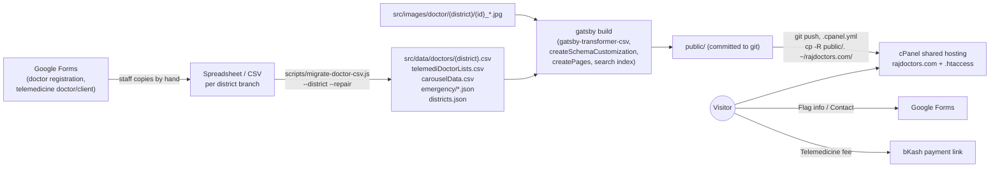
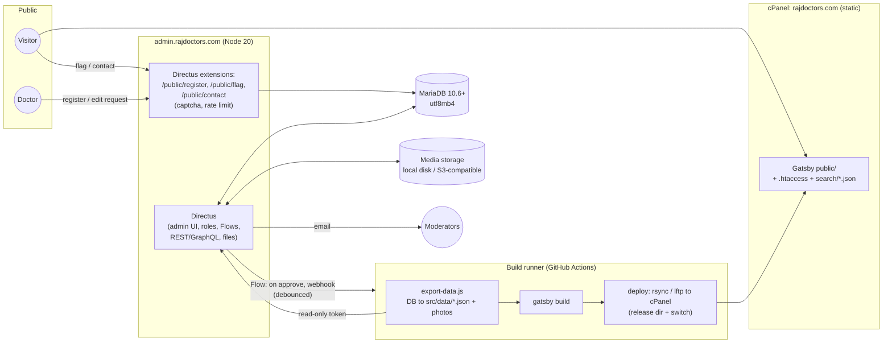
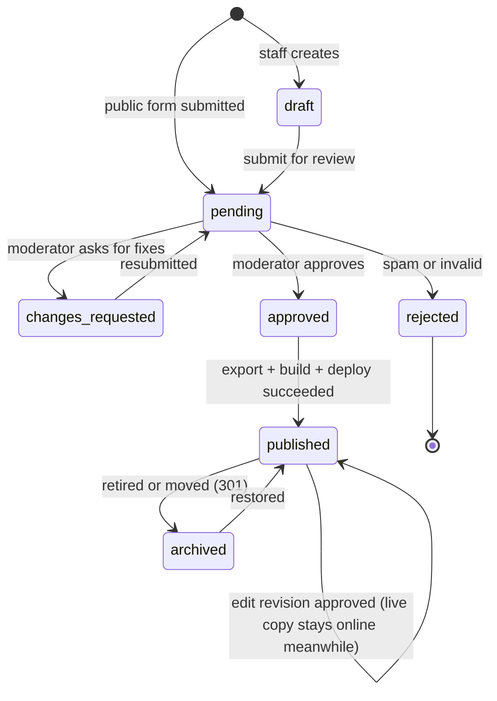

# RajDoctors: migration plan to MariaDB + approval backend

Status: **plan only, nothing migrated yet** · Branch `docs/mariadb-plan` (from `design/navigation`) · Oct 2026

---

## 1. Executive summary & recommendation

**Recommendation.** Make **MariaDB the single source of truth** for doctors,
chambers, districts, specialties, telemedicine, emergency numbers and the
carousel. Put **Directus (option A) on top of it** as the admin, moderation
and approval backend, and keep the **Gatsby 5 static site**. Gatsby gets its
data from an **export-to-JSON step**: a script reads the approved rows from
MariaDB and writes the same per-district files the site reads today. When
something is approved, a **webhook starts a rebuild + deploy** to cPanel.

Why:

* The site's strengths stay as they are: static, fast, cheap shared hosting,
  10k+ indexed URLs. Visitors never touch the database.
* The data problems we cleaned up by hand go away at the source: shifted
  columns, `&amp` splits, duplicate rows, garbled Bangla times, and the CSVs
  committed by hand to each district branch. Input is typed and validated,
  and every change is reviewed and versioned.
* Directus gives us roles, an approval flow, revisions, an activity log, file
  uploads, a REST/GraphQL API and email out of the box. That is roughly
  **3–5 weeks less work** than a custom admin. Our own code stays small: the
  public registration form, the export script and the build hook.
* Option B, a custom Node API (extending `api.rajdoctors.com`), stays the
  fallback if Directus can't be hosted (it needs a long-running Node 18/20
  process, see §3.4) or if its licence terms are unacceptable (§3.3).

Decision criteria and scoring: §3.3. Phased plan: **≈ 32–45 person-days to
production cutover** with Directus, **≈ 55–75** with a custom API (§11).

---

## 2. Current state

### 2.1 Data flow today



What exists in the repo today (`design/navigation`):

| Data | Where | Volume | Notes |
|---|---|---|---|
| Doctors | `src/data/doctors/{rajshahi,dhaka,sylhet}.csv` (28 columns, see `docs/DATA.md`) | Rajshahi 505 rows / 261 doctorIds (en+bn), Dhaka 1,900 (en), Sylhet 396 (en) | Bangla and English are **separate rows sharing `doctorId`**. Two chambers as flat columns `chamber1*`/`chamber2*`. `badges` and `clinicalExpertise` use `*` as the list separator |
| Districts | `src/data/districts.json` | 64 districts, 8 divisions, 3 enabled | `slugStyle` (`name` / `name_id`), `hasBangla`, `legacyHost`, `gitBranch` |
| Specialties | `src/utils/meta.data.js` (`menu`, `menuWithSynonyms`) | 38 specialties in 6 groups | Hard-coded JS. Misspellings ("Vuscular Surgery", "Opthalmology") are part of the URLs |
| Telemedicine | `src/data/telemediDoctorLists.csv` | 2 doctors | Global, not per district. Has phone/email/whatsapp/telegram |
| Carousel | `src/data/carouselData.csv` | 3 slots | References `doctorId` |
| Emergency | `src/data/emergency/{_national,rajshahi}.json` | groups → contacts | Other districts fall back to `_national.json` |
| Photos | `src/images/doctor/<district>/<id>_<name>.jpg` | Dhaka 1,900, Sylhet 396, Rajshahi 24 (+ `default.png`) | Matched by id prefix in the `photo` resolver |
| Slugs | `gatsby-node.js` `doctorSlug()` | ~2.8k doctor rows | `name` style (`dr-azizul-haque`) for Rajshahi, `name_id` (`dr-shayda-ali_emrlDu`) for Dhaka/Sylhet. Duplicate slug within a district: first row wins and the rest are **skipped** (13 build warnings today) |
| Search | `writeSearchIndexes()` → `public/search/<district>.json` | elasticlunr on `name`, `specialty` | Synonyms from `menuWithSynonyms` |
| Redirects | `scripts/generate-htaccess.js` → `static/.htaccess` | Old Rajshahi paths, sub-domain hosts | |
| Pages built | 10,164 (all locales) | | Clean build ≈ 350 s on the box (8 vCPU) |
| Forms | Google Forms: add doctor (`GATSBY_GOOGLE_ADD_DOCTOR`), telemedicine doctor (`GATSBY_ADD_TELEMEDICINE_DOCTOR`), telemedicine client (`GATSBY_ADD_TELEMEDICINE_CLIENT`), contact, flag-incorrect-info | | `siteMetadata.apiUrl = https://api.rajdoctors.com` is configured and `axios` is imported in `contact.js`/`flag.js`, but both components currently link to Google Forms. The API did not respond from the build box (TLS error), so what it runs needs checking (§12) |
| Payment | Static bKash link (BDT 300) on `/teledoctor/` | | Manual confirmation by phone/SMS |
| Deploy | `.cpanel.yml`: `cp -R public/. /home/monergho/rajdoctors.com/` | | `public/` is committed to git, so every data change also commits megabytes of build output |

### 2.2 Pain points (concrete, from our cleanup)

1. **Shifted columns.** Rajshahi Bangla rows doctorId 7, 25, 44, 53, 92, 175,
   184, 194 had their `chamber2` values one column to the left (address =
   visit time, visit time = phone), and doctorId 80 two columns.
   Dhaka/Sylhet needed `migrate-doctor-csv.js --repair`. Free-form
   spreadsheets allow this kind of mistake, and nothing checks for it.
2. **`&amp` / separator splits.** HTML entities and the `*` convention split
   values into the wrong cells. `*` was used both as a comma inside values and
   as a list separator, and `.replace(/\*/)` calls were scattered through the
   components until the schema cleanup.
3. **Duplicate rows.** Two source files (`doctorLists.csv` +
   `doctorListsCopy.csv`, merged with `isNew`) and repeated people (e.g.
   "Dr Md Tafiqul Islam" shows twice in search). 13 duplicate-slug pages are
   silently skipped (`professor-md-lutfor-rahman`, `dr-s-belal-hossain`, …).
4. **Garbled Bangla times.** Mixed digits, `PM`/`টা`, Unicode normalisation
   differences (the text diffs had to NFC-normalise). Visiting hours are free
   text with no validation and no consistent display.
5. **En/bn drift.** A Bangla row can miss a chamber the English row has (we
   copied addresses across by hand). Only Rajshahi has Bangla at all
   (`hasBangla`).
6. **Manual, branch-per-district workflow.** Data lived on the `dhaka`/`sylhet`
   branches and in `src/data - Copy`. Every update is edit CSV → commit →
   build → commit `public/` → push, so only a developer can publish.
7. **No review or history.** Whoever edits the CSV publishes. Google Form
   submissions are re-typed by hand, and flag/contact feedback never reaches
   the data.
8. **Reference data is code.** Adding a specialty means editing
   `meta.data.js`. Emergency numbers exist only for Rajshahi.

---

## 3. Target architecture



### 3.1 Components

| Component | Responsibility |
|---|---|
| **MariaDB** | Single source of truth, all tables in §4. Small data: ≈3k doctors now, ≈40–60k at 64 districts |
| **Backend** (Directus or custom API) | Staff login, CRUD, moderation queue, revisions, audit log, media upload + resize, email notifications, public submission endpoints, publish webhook |
| **Export step** (`scripts/export-data.js`, new) | Reads **only published** data and writes `src/data/doctors/<district>.json`, `districts.json`, `specialties.json`, `telemedicine.json`, `emergency/<district>.json`, `carousel.json`, photos into `src/images/doctor/<district>/`, and the generated block of `static/.htaccess` from `redirects`. Same shapes as today, so the `gatsby-node.js` changes stay small |
| **Gatsby site** | Unchanged URLs, templates, search index, ads, nav. `gatsby-transformer-csv` is replaced by `gatsby-transformer-json`; `createSchemaCustomization` stays |
| **Build runner** | GitHub Actions (free minutes are enough, §6.2), or cron/worker on the VPS |
| **Deploy** | rsync/lftp of `public/` into a new release folder on cPanel + switch. `public/` is no longer committed to git |

### 3.2 Option A: Directus on MariaDB

* Official MySQL/MariaDB support. Directus *introspects existing tables*, so
  we own the DDL (§4) and the database is not locked to Directus.
* Roles/permissions per collection, field and row. Filter rules such as
  "district in the user's districts" handle district editors.
* Built-in **revisions** and an **activity log** (who changed what, with a
  diff), a file library with on-the-fly image transforms, a translations
  interface for the `*_translations` tables (§4), and **Flows** (event →
  webhook / email / script) for the approval → rebuild trigger.
* Our extensions (TypeScript, ≈300–600 LOC): public endpoints with
  captcha and rate limit, a status-transition guard, slug + redirect
  generation on approve, and a revision diff panel.
* Weak spots: it needs a persistent Node process and ~512 MB–1 GB RAM.
  Licence: BSL 1.1 since v10, free for organisations under USD 5M
  revenue/funding (RajDoctors qualifies; confirm, §12). Major upgrades need
  some care.

### 3.3 Option B: custom Node API (Express/NestJS, extend `api.rajdoctors.com`)

* Full control, small runtime (runs fine under cPanel *Setup Node.js App* /
  Passenger), and it reuses whatever `api.rajdoctors.com` already does.
* We build everything ourselves: auth (sessions/JWT, password reset, 2FA),
  RBAC, an admin UI (React-admin or hand-built), revision storage and diff
  view, upload + resize, an email queue, an audit log, and tests. That is
  realistically **+25–30 person-days** compared with A, plus owning all of it
  afterwards.

| Criterion (weight) | A: Directus | B: Custom API |
|---|---|---|
| Time to first moderated publish (25%) | **5**: admin, roles, revisions built in | 2 |
| Data-quality controls: validation, typed fields, dropdowns (15%) | 4: field validation + our hooks | 5: anything we code |
| Approval / revision workflow (15%) | 4: status + Flows + revisions; "edit live profile as pending revision" needs a small extension (§5.3) | 4: exactly to spec, but built by us |
| Hosting fit on cPanel (15%) | 2–3: Passenger only if the plan allows enough RAM / a persistent process; a ~$6/mo VPS is safer | **4**: light Express app under Passenger |
| Maintenance for a 1–2 person team (15%) | **4**: upgrades only | 2: we own all code |
| Lock-in / portability (10%) | 4: plain SQL tables, we own the DDL | 5 |
| Cost (5%) | 4: free licence tier + VPS ~$6/mo | 4: same hosting, no licence |
| **Weighted score** | **≈ 4.0** | **≈ 3.4** |

**Recommendation: A (Directus)**, *unless* the hosting decision (§12 Q3)
rules out a persistent Node process with ≥ 1 GB RAM and a VPS is not wanted.
In that case go with B. B uses the same DDL and the same export step, so the
static site side is identical and we can switch later in either direction.

### 3.4 Hosting options

| | cPanel only | cPanel + small VPS (recommended) |
|---|---|---|
| Static site | cPanel (as now) | cPanel (as now) |
| MariaDB | cPanel MariaDB (CI reaches data through the backend API, not remote MySQL) | On the VPS (or keep the cPanel DB and allow the VPS IP) |
| Backend | cPanel *Setup Node.js App* (Phusion Passenger, Node 18/20). Passenger stops idle apps, and shared-plan memory limits (often 512 MB–1 GB) can kill Directus. Fine for option B | Directus in Docker (`directus/directus`), nginx + Let's Encrypt, 1–2 GB RAM VPS (Hetzner CX22 / DigitalOcean / a BD provider) |
| Builds | GitHub Actions | GitHub Actions, or on the VPS (2 vCPU/4 GB: ~10 min full build today) |
| Deploy | GitHub Actions → `lftp mirror -R` (FTPS) or `rsync` over SSH (if the plan has SSH) | same |

The **cPanel git deploy (`.cpanel.yml`)** is phased out: it requires
`public/` to be committed, which adds megabytes of build output to the repo
with every data change.

---

## 4. Data model

### 4.1 Conventions

* `ENGINE=InnoDB`, `DEFAULT CHARSET=utf8mb4 COLLATE=utf8mb4_unicode_520_ci`
  (MariaDB ≥ 10.6; on 10.10+ prefer `utf8mb4_uca1400_ai_ci` for better Bangla
  sorting). Bangla is stored **NFC-normalised**; the backend normalises on
  write.
* Surrogate `BIGINT UNSIGNED` ids. `legacy_*` columns keep the CSV ids
  (`doctorId` like `6` or `emrlDu`) because slugs and photo file names depend
  on them.
* Content tables carry `status`, `created_at/by` and `updated_at/by`. The
  export reads only `status = 'published'`.
* **Translations: separate `*_translations` tables** (one row per `locale`
  in {`en`,`bn`}) instead of `name_en`/`name_bn` columns. Reasons:
  - it matches today's data (en/bn rows sharing `doctorId`, Bangla optional
    per district);
  - it is Directus' native translations pattern;
  - a third locale needs no ALTER.

  Language-neutral facts (phones, rating, fee, photo, specialty) live once on
  the parent row, which ends the en/bn drift (pain point 5). Small lookup
  tables (districts, specialties, badges) use `name_en`/`name_bn` columns
  because they are fixed two-language labels.

### 4.2 DDL

```sql
-- ===================== geography =====================
CREATE TABLE divisions (
  id        SMALLINT UNSIGNED PRIMARY KEY AUTO_INCREMENT,
  slug      VARCHAR(40) NOT NULL UNIQUE,              -- 'rajshahi'
  name_en   VARCHAR(80) NOT NULL,
  name_bn   VARCHAR(80) NOT NULL,
  sort      SMALLINT NOT NULL DEFAULT 0
) ENGINE=InnoDB DEFAULT CHARSET=utf8mb4 COLLATE=utf8mb4_unicode_520_ci;

CREATE TABLE districts (
  id          SMALLINT UNSIGNED PRIMARY KEY AUTO_INCREMENT,
  division_id SMALLINT UNSIGNED NOT NULL,
  slug        VARCHAR(40) NOT NULL UNIQUE,            -- URL segment /<slug>/
  name_en     VARCHAR(80) NOT NULL,
  name_bn     VARCHAR(80) NOT NULL,
  enabled     BOOLEAN NOT NULL DEFAULT FALSE,         -- districts.json "enabled"
  has_bangla  BOOLEAN NOT NULL DEFAULT FALSE,         -- "hasBangla" (language toggle)
  slug_style  ENUM('name','name_id') NOT NULL DEFAULT 'name_id',
  legacy_host VARCHAR(120) NULL,                      -- 'dhaka.rajdoctors.com'
  is_default  BOOLEAN NOT NULL DEFAULT FALSE,
  CONSTRAINT fk_district_division FOREIGN KEY (division_id) REFERENCES divisions(id)
) ENGINE=InnoDB DEFAULT CHARSET=utf8mb4 COLLATE=utf8mb4_unicode_520_ci;

-- ===================== specialties =====================
CREATE TABLE specialty_groups (                       -- Medicine, Paediatrics, Surgery, Radiology
  id       SMALLINT UNSIGNED PRIMARY KEY AUTO_INCREMENT,
  name_en  VARCHAR(80) NOT NULL,
  name_bn  VARCHAR(80) NOT NULL,
  sort     SMALLINT NOT NULL DEFAULT 0
) ENGINE=InnoDB DEFAULT CHARSET=utf8mb4 COLLATE=utf8mb4_unicode_520_ci;

CREATE TABLE specialties (
  id        SMALLINT UNSIGNED PRIMARY KEY AUTO_INCREMENT,
  group_id  SMALLINT UNSIGNED NULL,                   -- NULL = shown under "More" (Gynaecology, Dental Surgery)
  code      VARCHAR(80) NOT NULL UNIQUE,              -- 'Cardiology' = value on doctors today + intl message id
  url_slug  VARCHAR(80) NOT NULL UNIQUE,              -- 'cardiology', 'vuscular surgery' (legacy spelling kept!)
  name_en   VARCHAR(80) NOT NULL,
  name_bn   VARCHAR(80) NOT NULL,
  sort      SMALLINT NOT NULL DEFAULT 0,
  CONSTRAINT fk_spec_group FOREIGN KEY (group_id) REFERENCES specialty_groups(id)
) ENGINE=InnoDB DEFAULT CHARSET=utf8mb4 COLLATE=utf8mb4_unicode_520_ci;

CREATE TABLE specialty_synonyms (                     -- menuWithSynonyms: 'heart' -> Cardiology
  id           INT UNSIGNED PRIMARY KEY AUTO_INCREMENT,
  specialty_id SMALLINT UNSIGNED NOT NULL,
  locale       ENUM('en','bn') NOT NULL DEFAULT 'en',
  term         VARCHAR(80) NOT NULL,
  UNIQUE KEY uq_syn (specialty_id, locale, term),
  CONSTRAINT fk_syn_spec FOREIGN KEY (specialty_id) REFERENCES specialties(id) ON DELETE CASCADE
) ENGINE=InnoDB DEFAULT CHARSET=utf8mb4 COLLATE=utf8mb4_unicode_520_ci;

-- ===================== media =====================
-- (With Directus, directus_files plays this role; same fields.)
CREATE TABLE media (
  id          BIGINT UNSIGNED PRIMARY KEY AUTO_INCREMENT,
  storage_key VARCHAR(255) NOT NULL UNIQUE,           -- 'doctor/dhaka/emrlDu_Dr.-Shayda-Ali.jpg'
  mime        VARCHAR(60) NOT NULL,
  width       SMALLINT UNSIGNED NULL,
  height      SMALLINT UNSIGNED NULL,
  bytes       INT UNSIGNED NULL,
  sha256      CHAR(64) NOT NULL,                      -- dedupe on import/upload
  alt_en      VARCHAR(200) NULL,
  alt_bn      VARCHAR(200) NULL,
  created_at  DATETIME NOT NULL DEFAULT CURRENT_TIMESTAMP,
  KEY ix_media_sha (sha256)
) ENGINE=InnoDB DEFAULT CHARSET=utf8mb4 COLLATE=utf8mb4_unicode_520_ci;

-- ===================== doctors =====================
CREATE TABLE doctors (
  id               BIGINT UNSIGNED PRIMARY KEY AUTO_INCREMENT,
  district_id      SMALLINT UNSIGNED NOT NULL,
  legacy_doctor_id VARCHAR(16) NULL,                  -- CSV doctorId ('6', 'emrlDu')
  specialty_id     SMALLINT UNSIGNED NOT NULL,
  rating           DECIMAL(2,1) NULL CHECK (rating BETWEEN 0 AND 5),
  fee_bdt          INT UNSIGNED NULL,                 -- parsed number when possible
  fee_text         VARCHAR(80) NULL,                  -- as entered ('500 / 300 report')
  is_new           BOOLEAN NOT NULL DEFAULT FALSE,    -- legacy ordering flag (isNew)
  sort_weight      INT NOT NULL DEFAULT 0,            -- future explicit ordering
  photo_id         BIGINT UNSIGNED NULL,
  status           ENUM('draft','pending','changes_requested','approved','published','rejected','archived')
                   NOT NULL DEFAULT 'draft',
  published_rev_id BIGINT UNSIGNED NULL,              -- revision currently live (5.3)
  source           ENUM('import','staff','self_registration') NOT NULL DEFAULT 'staff',
  bmdc_reg_no      VARCHAR(20) NULL,                  -- BMDC registration no. (validation)
  contact_email    VARCHAR(190) NULL,                 -- PII: never exported
  contact_phone    VARCHAR(30) NULL,                  -- PII: doctor's own number, never exported
  created_at       DATETIME NOT NULL DEFAULT CURRENT_TIMESTAMP,
  created_by       BIGINT UNSIGNED NULL,
  updated_at       DATETIME NOT NULL DEFAULT CURRENT_TIMESTAMP ON UPDATE CURRENT_TIMESTAMP,
  updated_by       BIGINT UNSIGNED NULL,
  UNIQUE KEY uq_doctor_legacy (district_id, legacy_doctor_id),
  UNIQUE KEY uq_doctor_bmdc (district_id, bmdc_reg_no),
  KEY ix_doctor_list (district_id, status, specialty_id, rating),
  CONSTRAINT fk_doc_district  FOREIGN KEY (district_id)  REFERENCES districts(id),
  CONSTRAINT fk_doc_specialty FOREIGN KEY (specialty_id) REFERENCES specialties(id),
  CONSTRAINT fk_doc_photo     FOREIGN KEY (photo_id)     REFERENCES media(id) ON DELETE SET NULL
) ENGINE=InnoDB DEFAULT CHARSET=utf8mb4 COLLATE=utf8mb4_unicode_520_ci;

CREATE TABLE doctor_translations (                    -- today: separate en/bn CSV rows
  id          BIGINT UNSIGNED PRIMARY KEY AUTO_INCREMENT,
  doctor_id   BIGINT UNSIGNED NOT NULL,
  locale      ENUM('en','bn') NOT NULL,
  name        VARCHAR(160) NOT NULL,                  -- 'Dr. Azizul Haque'
  degrees     VARCHAR(400) NULL,                      -- 'MBBS, MD (Internal Medicine)'
  designation VARCHAR(200) NULL,
  institute   VARCHAR(200) NULL,
  protocol    TEXT NULL,                              -- 'Please phone to provided number to book a serial'
  bio         TEXT NULL,
  UNIQUE KEY uq_doc_locale (doctor_id, locale),
  FULLTEXT KEY ft_doc_text (name, degrees, institute),
  CONSTRAINT fk_doctr_doc FOREIGN KEY (doctor_id) REFERENCES doctors(id) ON DELETE CASCADE
) ENGINE=InnoDB DEFAULT CHARSET=utf8mb4 COLLATE=utf8mb4_unicode_520_ci;

CREATE TABLE badges (                                 -- Busy, Trusted, Topper, Popular ... (BADGE_ICONS)
  id       SMALLINT UNSIGNED PRIMARY KEY AUTO_INCREMENT,
  code     VARCHAR(40) NOT NULL UNIQUE,
  label_en VARCHAR(60) NOT NULL,
  label_bn VARCHAR(60) NOT NULL,
  icon     VARCHAR(40) NULL
) ENGINE=InnoDB DEFAULT CHARSET=utf8mb4 COLLATE=utf8mb4_unicode_520_ci;

CREATE TABLE doctor_badges (
  doctor_id BIGINT UNSIGNED NOT NULL,
  badge_id  SMALLINT UNSIGNED NOT NULL,
  sort      SMALLINT NOT NULL DEFAULT 0,
  PRIMARY KEY (doctor_id, badge_id),
  CONSTRAINT fk_db_doc   FOREIGN KEY (doctor_id) REFERENCES doctors(id) ON DELETE CASCADE,
  CONSTRAINT fk_db_badge FOREIGN KEY (badge_id)  REFERENCES badges(id)
) ENGINE=InnoDB DEFAULT CHARSET=utf8mb4 COLLATE=utf8mb4_unicode_520_ci;

CREATE TABLE clinical_expertise_items (               -- clinicalExpertise, one row per item (was '*'-separated)
  id        BIGINT UNSIGNED PRIMARY KEY AUTO_INCREMENT,
  doctor_id BIGINT UNSIGNED NOT NULL,
  locale    ENUM('en','bn') NOT NULL,
  sort      SMALLINT NOT NULL DEFAULT 0,
  text      VARCHAR(300) NOT NULL,
  KEY ix_ce_doc (doctor_id, locale, sort),
  CONSTRAINT fk_ce_doc FOREIGN KEY (doctor_id) REFERENCES doctors(id) ON DELETE CASCADE
) ENGINE=InnoDB DEFAULT CHARSET=utf8mb4 COLLATE=utf8mb4_unicode_520_ci;

-- ===================== chambers (was chamber1*/chamber2*, now 0..n) =====================
CREATE TABLE chambers (
  id        BIGINT UNSIGNED PRIMARY KEY AUTO_INCREMENT,
  doctor_id BIGINT UNSIGNED NOT NULL,
  position  TINYINT UNSIGNED NOT NULL,                -- 1 = "Chamber One"
  kind      ENUM('chamber','hospital','residence') NOT NULL DEFAULT 'chamber',
  days_mask TINYINT UNSIGNED NULL,                    -- bit0 = Sat ... bit6 = Fri (optional, structured)
  opens_at  TIME NULL,                                -- optional, structured
  closes_at TIME NULL,
  lat       DECIMAL(9,6) NULL,
  lng       DECIMAL(9,6) NULL,
  UNIQUE KEY uq_chamber_pos (doctor_id, position),
  CONSTRAINT fk_ch_doc FOREIGN KEY (doctor_id) REFERENCES doctors(id) ON DELETE CASCADE
) ENGINE=InnoDB DEFAULT CHARSET=utf8mb4 COLLATE=utf8mb4_unicode_520_ci;

CREATE TABLE chamber_translations (
  id         BIGINT UNSIGNED PRIMARY KEY AUTO_INCREMENT,
  chamber_id BIGINT UNSIGNED NOT NULL,
  locale     ENUM('en','bn') NOT NULL,
  name       VARCHAR(200) NULL,                       -- chamberNName
  address    VARCHAR(400) NULL,                       -- chamberNAddress
  visit_time VARCHAR(200) NULL,                       -- chamberNVisitTime
  hours      VARCHAR(120) NULL,                       -- chamberNHours
  days       VARCHAR(120) NULL,                       -- chamberNDays
  off_days   VARCHAR(120) NULL,                       -- chamberNOffDays
  UNIQUE KEY uq_ch_locale (chamber_id, locale),
  CONSTRAINT fk_chtr_ch FOREIGN KEY (chamber_id) REFERENCES chambers(id) ON DELETE CASCADE
) ENGINE=InnoDB DEFAULT CHARSET=utf8mb4 COLLATE=utf8mb4_unicode_520_ci;

CREATE TABLE chamber_phones (                         -- '0721-771146/47, 01711-192600' -> 2 rows
  id         BIGINT UNSIGNED PRIMARY KEY AUTO_INCREMENT,
  chamber_id BIGINT UNSIGNED NOT NULL,
  sort       TINYINT UNSIGNED NOT NULL DEFAULT 0,
  display    VARCHAR(40) NOT NULL,                    -- shown as entered: '0721-771146/47'
  e164       VARCHAR(16) NULL,                        -- '+880721771146' for tel: links + validation
  label      VARCHAR(60) NULL,                        -- 'Serial', 'Reception'
  KEY ix_phone_e164 (e164),
  CONSTRAINT fk_ph_ch FOREIGN KEY (chamber_id) REFERENCES chambers(id) ON DELETE CASCADE
) ENGINE=InnoDB DEFAULT CHARSET=utf8mb4 COLLATE=utf8mb4_unicode_520_ci;

-- ===================== slugs & redirects =====================
CREATE TABLE doctor_slugs (                           -- current + historical slugs per locale
  id          BIGINT UNSIGNED PRIMARY KEY AUTO_INCREMENT,
  doctor_id   BIGINT UNSIGNED NOT NULL,
  district_id SMALLINT UNSIGNED NOT NULL,             -- denormalised for the unique key
  locale      ENUM('en','bn') NOT NULL,
  slug        VARCHAR(200) NOT NULL,                  -- 'dr-azizul-haque', Bangla slugs, 'dr-shayda-ali_emrlDu'
  is_current  BOOLEAN NOT NULL DEFAULT TRUE,
  created_at  DATETIME NOT NULL DEFAULT CURRENT_TIMESTAMP,
  UNIQUE KEY uq_slug (district_id, slug),             -- never a collision inside a district
  KEY ix_slug_doc (doctor_id, locale, is_current),
  CONSTRAINT fk_slug_doc FOREIGN KEY (doctor_id) REFERENCES doctors(id) ON DELETE CASCADE,
  CONSTRAINT fk_slug_district FOREIGN KEY (district_id) REFERENCES districts(id)
) ENGINE=InnoDB DEFAULT CHARSET=utf8mb4 COLLATE=utf8mb4_unicode_520_ci;

CREATE TABLE redirects (                              -- exported into .htaccess + createRedirect (dev)
  id         BIGINT UNSIGNED PRIMARY KEY AUTO_INCREMENT,
  from_path  VARCHAR(400) NOT NULL,                   -- '/rajshahi/doctor/old-slug/'
  to_path    VARCHAR(400) NOT NULL,
  code       SMALLINT NOT NULL DEFAULT 301,
  reason     ENUM('slug_change','merge','archive','legacy','manual') NOT NULL,
  created_at DATETIME NOT NULL DEFAULT CURRENT_TIMESTAMP,
  UNIQUE KEY uq_from (from_path(255))
) ENGINE=InnoDB DEFAULT CHARSET=utf8mb4 COLLATE=utf8mb4_unicode_520_ci;

-- ===================== telemedicine (global) =====================
CREATE TABLE tele_doctors (
  id                BIGINT UNSIGNED PRIMARY KEY AUTO_INCREMENT,
  legacy_id         VARCHAR(16) NULL UNIQUE,          -- telemediDoctorLists.csv id -> /teledoctor/<id>/
  doctor_id         BIGINT UNSIGNED NULL,             -- optional link to a listed doctor
  specialty_id      SMALLINT UNSIGNED NULL,
  name              VARCHAR(160) NOT NULL,
  degrees           VARCHAR(400) NULL,
  skills            VARCHAR(400) NULL,
  designation       VARCHAR(200) NULL,
  institute         VARCHAR(200) NULL,
  fee_bdt           INT UNSIGNED NULL,
  consultation_time VARCHAR(120) NULL,
  off_days          VARCHAR(120) NULL,
  phone             VARCHAR(30) NULL,                 -- PII: exported only with consent_public_contact
  email             VARCHAR(190) NULL,
  whatsapp          VARCHAR(30) NULL,
  telegram          VARCHAR(60) NULL,
  other_contacts    VARCHAR(300) NULL,
  consent_public_contact BOOLEAN NOT NULL DEFAULT FALSE,
  photo_id          BIGINT UNSIGNED NULL,
  status            ENUM('draft','pending','changes_requested','approved','published','rejected','archived')
                    NOT NULL DEFAULT 'draft',
  updated_at        DATETIME NOT NULL DEFAULT CURRENT_TIMESTAMP ON UPDATE CURRENT_TIMESTAMP,
  CONSTRAINT fk_tele_doc   FOREIGN KEY (doctor_id)    REFERENCES doctors(id) ON DELETE SET NULL,
  CONSTRAINT fk_tele_spec  FOREIGN KEY (specialty_id) REFERENCES specialties(id),
  CONSTRAINT fk_tele_photo FOREIGN KEY (photo_id)     REFERENCES media(id) ON DELETE SET NULL
) ENGINE=InnoDB DEFAULT CHARSET=utf8mb4 COLLATE=utf8mb4_unicode_520_ci;

-- ===================== emergency (NULL district = national) =====================
CREATE TABLE emergency_groups (
  id          INT UNSIGNED PRIMARY KEY AUTO_INCREMENT,
  district_id SMALLINT UNSIGNED NULL,                 -- NULL = _national.json
  service_en  VARCHAR(120) NOT NULL,                  -- 'Fire Service'
  service_bn  VARCHAR(120) NULL,
  sort        SMALLINT NOT NULL DEFAULT 0,
  status      ENUM('draft','published','archived') NOT NULL DEFAULT 'draft',
  CONSTRAINT fk_eg_district FOREIGN KEY (district_id) REFERENCES districts(id)
) ENGINE=InnoDB DEFAULT CHARSET=utf8mb4 COLLATE=utf8mb4_unicode_520_ci;

CREATE TABLE emergency_contacts (
  id       INT UNSIGNED PRIMARY KEY AUTO_INCREMENT,
  group_id INT UNSIGNED NOT NULL,
  name_en  VARCHAR(160) NOT NULL,                     -- 'Rajshahi Fire Station with Ambulence'
  name_bn  VARCHAR(160) NULL,
  phones   VARCHAR(200) NOT NULL,                     -- display string '0721-774224, 01730-336655'
  sort     SMALLINT NOT NULL DEFAULT 0,
  CONSTRAINT fk_ec_group FOREIGN KEY (group_id) REFERENCES emergency_groups(id) ON DELETE CASCADE
) ENGINE=InnoDB DEFAULT CHARSET=utf8mb4 COLLATE=utf8mb4_unicode_520_ci;

-- ===================== featured / carousel =====================
CREATE TABLE featured_slots (                         -- carouselData.csv (slot, doctorId, ...)
  id          INT UNSIGNED PRIMARY KEY AUTO_INCREMENT,
  district_id SMALLINT UNSIGNED NULL,                 -- NULL = all districts
  slot        TINYINT UNSIGNED NOT NULL,
  doctor_id   BIGINT UNSIGNED NOT NULL,
  starts_on   DATE NULL,                              -- paid placements can expire
  ends_on     DATE NULL,
  UNIQUE KEY uq_slot (district_id, slot),
  CONSTRAINT fk_fs_doc      FOREIGN KEY (doctor_id)   REFERENCES doctors(id) ON DELETE CASCADE,
  CONSTRAINT fk_fs_district FOREIGN KEY (district_id) REFERENCES districts(id)
) ENGINE=InnoDB DEFAULT CHARSET=utf8mb4 COLLATE=utf8mb4_unicode_520_ci;

-- ===================== users & roles =====================
-- (With Directus, directus_users / directus_roles / policies replace these two tables;
--  user_districts stays as a custom M2M used in permission filters.)
CREATE TABLE users (
  id            BIGINT UNSIGNED PRIMARY KEY AUTO_INCREMENT,
  email         VARCHAR(190) NOT NULL UNIQUE,
  password_hash VARCHAR(255) NULL,                    -- argon2id; NULL = magic-link only (doctors)
  display_name  VARCHAR(160) NOT NULL,
  role          ENUM('admin','moderator','district_editor','doctor') NOT NULL,
  doctor_id     BIGINT UNSIGNED NULL,                 -- role = doctor: own profile only
  is_active     BOOLEAN NOT NULL DEFAULT TRUE,
  totp_secret   VARBINARY(64) NULL,                   -- 2FA, required for admin/moderator
  last_login_at DATETIME NULL,
  created_at    DATETIME NOT NULL DEFAULT CURRENT_TIMESTAMP,
  CONSTRAINT fk_user_doc FOREIGN KEY (doctor_id) REFERENCES doctors(id) ON DELETE SET NULL
) ENGINE=InnoDB DEFAULT CHARSET=utf8mb4 COLLATE=utf8mb4_unicode_520_ci;

CREATE TABLE user_districts (                         -- district editors' / moderators' scope
  user_id     BIGINT UNSIGNED NOT NULL,
  district_id SMALLINT UNSIGNED NOT NULL,
  PRIMARY KEY (user_id, district_id),
  CONSTRAINT fk_ud_user     FOREIGN KEY (user_id)     REFERENCES users(id) ON DELETE CASCADE,
  CONSTRAINT fk_ud_district FOREIGN KEY (district_id) REFERENCES districts(id)
) ENGINE=InnoDB DEFAULT CHARSET=utf8mb4 COLLATE=utf8mb4_unicode_520_ci;

-- ===================== submissions, revisions, audit, builds =====================
CREATE TABLE submissions (                            -- public registration / edit requests / flags / contact
  id              BIGINT UNSIGNED PRIMARY KEY AUTO_INCREMENT,
  kind            ENUM('doctor_registration','doctor_edit','tele_doctor_registration',
                       'tele_client_request','flag','contact') NOT NULL,
  district_id     SMALLINT UNSIGNED NULL,
  doctor_id       BIGINT UNSIGNED NULL,               -- target of an edit / flag
  payload         LONGTEXT NOT NULL CHECK (JSON_VALID(payload)),
  submitter_name  VARCHAR(160) NULL,
  submitter_phone VARCHAR(30) NULL,                   -- PII
  submitter_email VARCHAR(190) NULL,                  -- PII
  ip_hash         BINARY(32) NULL,                    -- sha256(ip + salt): rate limiting / abuse only
  status          ENUM('new','in_review','converted','rejected','spam') NOT NULL DEFAULT 'new',
  handled_by      BIGINT UNSIGNED NULL,
  created_at      DATETIME NOT NULL DEFAULT CURRENT_TIMESTAMP,
  KEY ix_sub_queue (status, kind, created_at),
  CONSTRAINT fk_sub_doc      FOREIGN KEY (doctor_id)   REFERENCES doctors(id) ON DELETE SET NULL,
  CONSTRAINT fk_sub_district FOREIGN KEY (district_id) REFERENCES districts(id)
) ENGINE=InnoDB DEFAULT CHARSET=utf8mb4 COLLATE=utf8mb4_unicode_520_ci;

CREATE TABLE doctor_revisions (                       -- full snapshot: doctor + translations + chambers + phones + badges + expertise
  id            BIGINT UNSIGNED PRIMARY KEY AUTO_INCREMENT,
  doctor_id     BIGINT UNSIGNED NOT NULL,
  snapshot      LONGTEXT NOT NULL CHECK (JSON_VALID(snapshot)),
  status        ENUM('draft','pending','changes_requested','approved','rejected','superseded')
                NOT NULL DEFAULT 'draft',
  submission_id BIGINT UNSIGNED NULL,
  author_id     BIGINT UNSIGNED NULL,
  reviewer_id   BIGINT UNSIGNED NULL,
  review_note   VARCHAR(1000) NULL,
  created_at    DATETIME NOT NULL DEFAULT CURRENT_TIMESTAMP,
  reviewed_at   DATETIME NULL,
  KEY ix_rev_doc (doctor_id, status, created_at),
  CONSTRAINT fk_rev_doc FOREIGN KEY (doctor_id)     REFERENCES doctors(id) ON DELETE CASCADE,
  CONSTRAINT fk_rev_sub FOREIGN KEY (submission_id) REFERENCES submissions(id) ON DELETE SET NULL
) ENGINE=InnoDB DEFAULT CHARSET=utf8mb4 COLLATE=utf8mb4_unicode_520_ci;

ALTER TABLE doctors
  ADD CONSTRAINT fk_doc_pubrev FOREIGN KEY (published_rev_id) REFERENCES doctor_revisions(id) ON DELETE SET NULL;

CREATE TABLE audit_log (                              -- (Directus: directus_activity + directus_revisions)
  id        BIGINT UNSIGNED PRIMARY KEY AUTO_INCREMENT,
  at        DATETIME(3) NOT NULL DEFAULT CURRENT_TIMESTAMP(3),
  user_id   BIGINT UNSIGNED NULL,
  action    VARCHAR(40) NOT NULL,                     -- create|update|delete|approve|reject|publish|login|export
  entity    VARCHAR(60) NOT NULL,
  entity_id VARCHAR(40) NOT NULL,
  diff      LONGTEXT NULL CHECK (diff IS NULL OR JSON_VALID(diff)),
  ip_hash   BINARY(32) NULL,
  KEY ix_audit_entity (entity, entity_id, at),
  KEY ix_audit_user (user_id, at)
) ENGINE=InnoDB DEFAULT CHARSET=utf8mb4 COLLATE=utf8mb4_unicode_520_ci;

CREATE TABLE builds (                                 -- publish history + rollback pointer
  id           BIGINT UNSIGNED PRIMARY KEY AUTO_INCREMENT,
  triggered_by BIGINT UNSIGNED NULL,
  reason       VARCHAR(200) NOT NULL,
  data_hash    CHAR(64) NULL,                         -- sha256 of the export bundle
  ci_run_url   VARCHAR(300) NULL,
  status       ENUM('queued','running','succeeded','failed','rolled_back') NOT NULL DEFAULT 'queued',
  release_dir  VARCHAR(120) NULL,                     -- 'releases/20261012T0310Z'
  started_at   DATETIME NULL,
  finished_at  DATETIME NULL
) ENGINE=InnoDB DEFAULT CHARSET=utf8mb4 COLLATE=utf8mb4_unicode_520_ci;
```

Notes:

* `visit_time`, `hours` and `days` stay **text**: that is what moderators type
  and what the pages show, so the output is unchanged. `days_mask`,
  `opens_at` and `closes_at` are optional structured fields. The import fills
  them where it can parse the text; later they power "open now" and the
  validation (pain point 4).
* A view `v_doctor_export` (published doctors × current slugs × translations ×
  chambers × phones) keeps the export a plain `SELECT` and is also the
  allow-list for exported columns (§9).
* Expected volume at 64 districts: ~40–60k doctors, ~120k chambers, ~200k
  phones. That is small for InnoDB. The listed indexes cover the export
  (`district_id, status`) and the moderation queues.

---

## 5. Workflow

### 5.1 Entry points

| Who | How | Replaces |
|---|---|---|
| Doctor / chamber staff | Public bilingual form `/register/` on the static site (React → `POST /public/register` on the backend). Steps: identity (name, BMDC no., specialty, district), degrees/designation/institute, chambers (repeatable; phone fields with BD masks), photo, consent. Creates a `submissions` row | `GATSBY_GOOGLE_ADD_DOCTOR` Google Form |
| Telemedicine doctor | Same form, `kind = tele_doctor_registration` | `GATSBY_ADD_TELEMEDICINE_DOCTOR` |
| Telemedicine client | Request form on `/teledoctor/` → `submissions(kind = tele_client_request)` + email to staff. The bKash step is unchanged at first (§7) | `GATSBY_ADD_TELEMEDICINE_CLIENT` |
| Visitor | "Flag incorrect info" on doctor pages (doctor id pre-filled), contact form | Google Forms in `flag.js` / `contact.js` |
| Staff (district editor) | Admin UI: create/edit doctors in their districts | Editing CSVs |
| Doctor, logged in (later phase) | Magic-link login → "Edit my profile" creates a pending revision | — |

### 5.2 Validation rules (enforced server-side, mirrored in the form)

* **Text hygiene**: NFC-normalise, collapse whitespace, decode/reject HTML
  entities (`&amp` → `&`), reject HTML tags, strip doubled honorifics
  ("Dr. Dr.").
* **Name** required for every locale that will be shown (`bn` required only
  where `has_bangla`).
* **Specialty** must be an id from `specialties`. **District** must be
  enabled (or "requested district", flagged for an admin).
* **Phones**: each must parse as a Bangladesh number: mobile
  `^(\+?880|0)1[3-9]\d{8}$`, or a landline with area code (`0721-771146`).
  Extensions like `/47` are allowed in `display`. Normalised to `e164`.
* **Anti-shift checks** (the `migrate-doctor-csv.js --repair` heuristics
  become validators): a phone-like value in a name, address or time field, or
  a time-like value in an address field, gets **rejected with a field-level
  message**.
* **Visit time / hours**: free text, but must contain a time pattern
  (`\d{1,2}[.:]\d{2}` with AM/PM or `টা`/`মিনিট`, Bangla digits `০–৯`
  allowed and normalised for the structured fields).
* **Duplicates**: same BMDC no. in the district, same `e164` phone + similar
  name (Levenshtein ≤ 3 on the normalised name), or same photo sha256 →
  "possible duplicate of #id" banner for the moderator (not an automatic
  rejection).
* **Slug**: generated with the existing `doctorSlug()` rules (`name` vs
  `name_id` per district) and stored. Unique per district (`uq_slug`). A
  collision gets `-2` (`name` style) or keeps the id suffix (`name_id`).
  Pages are never silently skipped again (pain point 3).
* **Photo**: JPEG/PNG/WebP, ≤ 5 MB, ≥ 200×200 px (today's build warns about
  smaller images), EXIF stripped, square crop preview.
* **Staff-only fields**: rating (0–5, one decimal), badges, `is_new`,
  featured slots.

### 5.3 Statuses and revisions

New profiles move through `doctors.status`. **Edits to a live profile never
change the live data directly.** They create a `doctor_revisions` snapshot,
and the profile stays `published` with `published_rev_id` pointing at the
current version. When the new revision is approved, it is applied to the
tables and becomes `published_rev_id` after the next successful build.



* Only **moderator/admin** can set `approved`/`rejected` (status-transition
  guard hook). District editors and doctors can only submit.
* `changes_requested` requires a note, which is emailed to the submitter.
* Archiving creates a redirect to the district speciality page (§10).

### 5.4 Moderation UI (Directus)

* Saved views: *Pending (my districts)*, *Changes requested > 7 days*,
  *Flags*, *Possible duplicates*, *Published without photo*, *Bangla
  missing* (for `has_bangla` districts).
* A revision diff panel (custom panel extension) shows the snapshot against
  the live profile, field by field, en and bn side by side, with buttons
  **Approve / Request changes / Reject**.
* **Preview** button: renders the profile with the real doctor-page
  components (§6.4).
* Bulk actions: approve selected, set badge, move district.

### 5.5 Notifications (email)

| Event | To |
|---|---|
| New registration / edit request | Moderators of that district: daily digest at 09:00 BDT |
| New flag | Moderators of that district, immediately |
| Changes requested / approved / rejected | Submitter (if an email was given), bilingual template |
| Published (first time) | Doctor: "your profile is live" + link |
| Build failed | Admins (GitHub Actions failure step) |
| Weekly summary | Admins: counts by status, oldest pending, build stats |

Transport: SMTP from the cPanel mailbox (`help@rajdoctors.com`), or a
transactional provider (Brevo/Mailgun free tier) for better deliverability.

### 5.6 Approval → publish webhook

A Directus Flow on approval (doctors, revisions, `tele_doctors`,
`emergency_*`, `featured_slots`, `districts`, `specialties`) sets
`publish_requested_at`. A scheduled Flow (every 5 min) then sends **one**
`repository_dispatch` (`event_type: publish`) to GitHub if anything changed
since the last build. Approving 30 profiles therefore triggers one build.
The workflow runs with `concurrency: publish` and `cancel-in-progress:
false`, records itself in `builds`, and on success marks the approved rows
`published`. On failure they stay `approved` and admins get an email.

---

## 6. Publishing pipeline

### 6.1 How Gatsby gets the data: options

| Option | Pros | Cons |
|---|---|---|
| `gatsby-source-mysql` (direct SQL during the build) | No export step | Plugin unmaintained for Gatsby 5. The DB must be reachable from CI (remote MySQL + IP allow-list on cPanel). Schema is inferred, so our explicit `Doctor` type would have to be rebuilt on top of it |
| Source from the API (Directus REST/GraphQL via a custom `sourceNodes`) | Always live | Build depends on API uptime. Paging 60k rows on every build is slow. No artefact to diff or roll back |
| **Export to JSON (recommended)** | `scripts/export-data.js` writes `src/data/**/*.json` in today's shapes, so Gatsby changes are minimal (`gatsby-transformer-json`, same `createSchemaCustomization`). The export is an **artefact** we can diff, cache, hash (`builds.data_hash`) and roll back. Local dev keeps working offline with a downloaded export | One more script (≈1–2 days) |

Export shape, compatible with the current `Doctor` type (so templates, search
index and slugs stay as they are):

```json
{
  "district": "rajshahi", "doctorId": "6", "lang": "en",
  "name": "Dr. Azizul Haque", "specialty": "Medicine",
  "degrees": "MBBS, MD (Internal Medicine)", "rating": "4.3",
  "badges": ["Busy", "Trusted"], "isNew": false,
  "slug": "dr-azizul-haque",
  "chambers": [
    { "number": 1, "name": "…", "address": "…",
      "phones": ["0721-771146/47", "01711-192600"],
      "visitTime": "…", "hours": "…", "days": "…", "offDays": "…" }
  ],
  "clinicalExpertise": ["…", "…"],
  "updatedAt": "2026-10-12T03:10:00Z"
}
```

One object per (doctor, locale), as with today's rows. The export writes the
**slug explicitly** (from `doctor_slugs`), and `onCreateNode` uses it when
present, falling back to `doctorSlug()`. So fixing a typo in a name no longer
changes the URL; only an explicit slug change does, and that adds a redirect
(§10). `chambers` becomes a real array, so the `chambers` resolver just
returns it.

### 6.2 Build times

Measured now: **10,164 pages, clean build ≈ 350 s** on 8 vCPU, including
~2,300 photos through `gatsby-plugin-image`.

| Scale | Pages (all locales) | Photos | Clean build, 8 vCPU | GitHub Actions 4 vCPU: clean / with cache |
|---|---|---|---|---|
| Today (3 districts) | ~10k | 2.3k | ~6 min | ~10 min / ~3–5 min |
| 13 districts (old branches) | ~40k | ~9k | ~20–25 min | ~35 min / ~8–10 min |
| 64 districts (~40–60k doctors) | ~150–200k | ~40k | 60–90 min | too slow without the mitigations below |

Mitigations, in order of value:

1. **Cache `.cache/` and `public/`** between CI runs (`actions/cache` keyed
   on the lockfile + a hash of `gatsby-*.js`). Gatsby 5 then rebuilds only
   changed pages and image derivatives. A typical "one doctor approved"
   publish takes **2–5 min**.
2. **Photo pipeline outside Gatsby**: resize to fixed 200×200 WebP + JPEG at
   upload (Directus/sharp), and render doctor photos as plain
   ``. This removes the largest build
   cost.
3. **Stop emitting the redundant `/en/` copies.** gatsby-plugin-intl writes
   `/x/`, `/en/x/` and `/bn/x/`, and canonicals already point to `/x/`, so
   this cuts English pages by half. Add a 301 `/en/* → /*`.
4. Emit `/bn/` pages only for districts with `has_bangla`. Today every
   district gets Bangla copies that fall back to English.
5. Last resort: one build per district (shards into `public/<district>/`, a
   matrix job), plus a small "global" build. Gatsby DSG/SSR is not an
   option on static cPanel.

### 6.3 Deploy & rollback

1. CI builds `public/`, then `rsync -a --delete` (SSH) or `lftp mirror -R
   --parallel=8` (FTPS) into `~/releases/<timestamp>/` on cPanel.
2. Atomic switch: `~/rajdoctors.com` becomes a symlink to the current release
   (`ln -sfn`). If the host forbids a symlinked docroot, upload to
   `~/rajdoctors.com.next` and swap with two `mv` calls (sub-second).
3. Keep the last **5 releases**. **Rollback** = repoint the symlink: one SSH
   command, or a `rollback` workflow taking a build id. The build is marked
   `rolled_back`.
4. Smoke test after the switch: `/`, `/rajshahi/`, one random doctor per
   district, `/search/<district>.json` → 200 and the doctor's name in
   `<title>`. Failure triggers an automatic rollback.
5. `.cpanel.yml` and the committed `public/` are removed after 2 weeks of
   green deploys.

### 6.4 Previews for moderators

* **Phase 3 (cheap)**: Directus "Preview" opens
  `https://admin.rajdoctors.com/preview/doctor/<id>?rev=<rev>`, a small
  client-rendered page using the **same doctor-page components**
  (`CardSquare`, `DoctorHero`, `CardChamberInfo`, styles from
  `src/styles/doctor-page.scss`) and reading the revision snapshot through
  the API. Moderators see the real layout without a build.
* **Optional**: a `preview` workflow that builds one district from approved +
  pending data into a password-protected `preview.rajdoctors.com`.

### 6.5 Cache / CDN

The static files are already fine on cPanel. An optional free **Cloudflare**
in front adds HTTP/3, Brotli and edge caching. Rules: HTML `max-age=0,
s-maxage=300`; hashed JS/CSS and `/static/` `immutable` for 1 year;
`/search/*.json` for 1 hour. CI purges the cache after each deploy (one API
call). The `.htaccess` redirects keep working behind it.

---

## 7. Live dynamic features

| Feature | Today | Plan |
|---|---|---|
| Reviews | Placeholder "Currntly no user reviews…" | Later phase (optional): `reviews` table (doctor, rating, text, phone-OTP verified, status). Moderated and **published through the build**, so the static site has no live writes. Ratings stay staff-controlled until reviews have volume |
| Flag incorrect info | Google Form link | Backend endpoint → `submissions(kind = flag, doctor_id)`. One click in the moderation UI turns a flag into a draft revision with the flagged field highlighted |
| Contact form | Google Form link (`axios` imported but unused; `apiUrl` = api.rajdoctors.com) | Backend endpoint → `submissions(kind = contact)` + email. Find out what `api.rajdoctors.com` runs and retire or merge it (§12) |
| Telemedicine | Google Form + static bKash link (BDT 300), confirmation by phone/SMS | **Phase 4**: same flow, but the form posts to `submissions`, and staff record the bKash TrxID on the request. **Later (optional)**: `tele_bookings` (slot, status, TrxID) + **bKash Tokenized Checkout** (merchant account, payment callback marks paid). Needs a merchant agreement, so it stays out of the critical path |
| Search | Static per-district elasticlunr JSON | Unchanged (built from the export). Synonyms come from `specialty_synonyms` |
| Ads | Static AdSense slots (`docs/ADS.md`) | Unchanged |

---

## 8. Data migration

### 8.1 Import scripts (`scripts/import/`, Node, idempotent, `--dry-run`)

1. `import-reference.js`:
   - `districts.json` → `divisions`, `districts`;
   - `meta.data.js` → `specialty_groups`, `specialties` (`url_slug` =
     today's `spec.toLowerCase()`, so "vuscular surgery" and "opthalmology"
     are kept), `specialty_synonyms`;
   - badge codes found in the CSVs → `badges`.
2. `import-doctors.js --district=<slug>`: reads the **cleaned**
   `src/data/doctors/<district>.csv` (after `--repair`) and groups rows by
   `(district, doctorId)`. The `en` row (or an empty `lang`, which exists in
   Rajshahi) becomes the parent + the `en` translation; the `bn` row becomes
   the `bn` translation.
3. `import-photos.js`: `src/images/doctor/<district>/<id>_*.jpg` → `media`
   (sha256 dedupe) → `doctors.photo_id`. `default.png` is not imported; the
   site falls back to it.
4. `import-tele.js`, `import-emergency.js`, `import-carousel.js`.
5. `import-redirects.js`: the rules from `scripts/generate-htaccess.js` →
   `redirects(reason = legacy)`. Those rules are still generated by the
   script; the table is for collision checks.

### 8.2 Column mapping

Doctors (`src/data/doctors/<district>.csv`):

| CSV column | Target |
|---|---|
| `district` | `doctors.district_id` (by `districts.slug`) |
| `doctorId` | `doctors.legacy_doctor_id` |
| `lang` | `doctor_translations.locale` (empty → `en`) |
| `name` | `doctor_translations.name`; slug → `doctor_slugs.slug`, computed **once** with today's `doctorSlug()` and then stored |
| `specialty` | `doctors.specialty_id` (match `specialties.code`, case-insensitive; unknown → report) |
| `degrees`, `designation`, `institute`, `protocol` | `doctor_translations.*` |
| `rating` | `doctors.rating` (non-numeric → NULL + report) |
| `fee` | `doctors.fee_text` (+ `fee_bdt` when numeric) |
| `badges` (`*`-separated) | `badges` + `doctor_badges` (taken from the `en` row; Bangla labels from `badges.label_bn`) |
| `isNew` | `doctors.is_new` |
| `clinicalExpertise` (`*`-separated) | `clinical_expertise_items` (per locale, `sort` = position) |
| `chamberNName`, `chamberNAddress`, `chamberNVisitTime`, `chamberNHours`, `chamberNDays`, `chamberNOffDays` (N = 1, 2) | `chambers(position = N)` + `chamber_translations` for the row's locale |
| `chamberNPhone` | `chamber_phones` (split on `,` `;` and spaces; keep `display`, compute `e164`). Taken from the `en` row; a different `bn` phone goes to the report |

Other files:

| Source | Target |
|---|---|
| `telemediDoctorLists.csv`: `id,name,specialty,degrees,skills,designation,institute,fee,consultationTime,offDays,phone,email,whatsapp,telegram,otherContacts` | `tele_doctors` 1:1 (`legacy_id` = `id`; `consent_public_contact = TRUE` for the 2 current doctors, since their contacts are public today) |
| `carouselData.csv`: `slot,doctorId,name,…` | `featured_slots(district = rajshahi, slot, doctor_id)`; the other columns are derived from the doctor |
| `emergency/_national.json`, `emergency/rajshahi.json` | `emergency_groups` (district NULL / rajshahi) + `emergency_contacts` |
| `districts.json` | `divisions`, `districts` (`gitBranch` is dropped) |

### 8.3 Dedupe strategy

* **Same `doctorId` + same `lang` twice** in a district (left over from the
  old Copy-file overlap): keep the **first** row, matching today's "first row
  wins" behaviour. Later rows go to `duplicates.csv`.
* **Same slug, different `doctorId`** (the 13 warnings): import both. The
  first keeps the existing URL; the second gets a suffixed slug, status
  `pending`, and a "possible duplicate" note. **A moderator decides** whether
  to merge; a merge adds `redirects(reason = merge)`. Since these pages are
  not online today, nothing breaks.
* **Same person in two districts**: kept as separate district-scoped
  profiles (linking them is a later idea).
* **Same phone + similar name inside a district**: flagged in the report, not
  merged automatically.

### 8.4 Validation report (every dry run)

`import-report.html` + CSV, per district:
* counts: rows, doctors, en/bn pairs, chambers, phones, photos
  matched/missing;
* every failed rule from §5.2 (phone in address, time in name, unknown
  specialty, rating out of range, missing Bangla where `has_bangla`,
  unparseable phone), each with the CSV line number.

The import refuses to commit while `critical > 0`.

### 8.5 Equivalence check (the gate for cutover)

Export from the DB → build, then compare with the current CSV build using
the tooling from the redesigns (`textdiff.py`): **identical page path list,
identical `<main>` text, titles, descriptions, canonicals and JSON-LD**.
Every allowed difference is listed explicitly, for example pages that newly
appear for previously skipped duplicate slugs.

### 8.6 Cutover checklist

1. Announce a freeze on CSV edits. Tag the last CSV commit `pre-db-cutover`.
2. Final import → clean validation report → equivalence check green.
3. Moderator accounts created (2FA on), training done.
4. First production build from the DB → deploy into a release dir → smoke
   test. The previous release stays available for instant rollback.
5. Switch the registration, flag, contact and telemedicine links to the new
   forms (one deploy).
6. Set the Google Forms to "not accepting responses" with a link to the new
   forms, and import their unprocessed responses into `submissions`.
7. Move the CSVs out of the build (`src/data/doctors/*.csv` → archive), stop
   committing `public/`, retire `.cpanel.yml`.
8. Watch for 2 weeks: Search Console coverage and "Not found", 404s in the
   cPanel access log, submission volume, build durations.

---

## 9. Security & privacy

**Authentication**
* Directus local auth (argon2). **TOTP 2FA required** for admin and
  moderator. Tokens in httpOnly cookies.
* Admin UI on its own sub-domain (`admin.rajdoctors.com`), optionally behind
  Cloudflare Access or an IP allow-list.
* Doctors log in by magic link only (no passwords to leak or reset).

**Roles**

| Role | Can |
|---|---|
| admin | Everything: users, districts, specialties, badges, builds, rollback |
| moderator | Approve / reject / request changes in assigned (or all) districts, edit any doctor there, handle flags and contact messages |
| district_editor | Create and edit drafts, submit for review, **only in their `user_districts`**. Cannot approve or publish |
| doctor | View and edit **their own** profile through revisions only. Cannot change rating, badges, `is_new`, district or slug |
| public | `POST /public/*` only |

**Public forms**
* Cloudflare Turnstile (free) or hCaptcha, plus a honeypot field.
* Rate limits per `ip_hash` (5/hour, 20/day) and per phone number. Payload
  size limit.
* Uploads: MIME sniffing, re-encoding through sharp, kept in quarantine until
  approval.
* Nothing becomes public without moderator approval.

**PII**
* Chamber phone numbers are **public by design**; that is the service.
* Doctors' personal phone/email, BMDC number, and submitter name/phone/email
  are **never exported**. The export reads only the `v_doctor_export` view,
  a deny-by-default column allow-list.
* A CI check fails the build if an email address or a non-chamber phone
  number appears in `src/data`.
* Submissions are purged 12 months after they were handled. `ip_hash` is
  salted and never stored raw.

**Legal context (Bangladesh)**
* The Digital Security Act 2018 was replaced by the **Cyber Security Act
  2023**. A personal-data-protection law has been in draft/ordinance stages,
  so follow GDPR-like basics regardless.
* Explicit consent checkbox on registration ("I agree that my chamber
  details are published on rajdoctors.com").
* Update the existing `/privacy-policy/`: what is stored, why, how long,
  where (mention it if the VPS is outside Bangladesh).
* Removal on request within 7 days (archive + 301) and data export on
  request.

**Backups**
* Nightly `mariadb-dump --single-transaction` + media sync, encrypted
  (age/gpg) and pushed off-site (Backblaze B2 / S3). Keep 30 daily and 12
  monthly.
* Binlog on the VPS for point-in-time recovery. cPanel backups stay as a
  second copy.
* **Quarterly restore drill** into a scratch DB, then an export + build from
  it.

**Secrets**
* None in git. Today's `.env.*` only hold public `GATSBY_*` values and the ad
  slot.
* DB passwords, the Directus `KEY`/`SECRET`, SMTP, the GitHub dispatch token
  (fine-grained, `actions:write` on this repo only) and the cPanel SSH key /
  FTP password live in the VPS `.env` (mode 600) and GitHub Actions secrets.
* Rotate when someone leaves.

**Hardening**
* The DB is never exposed publicly (localhost / private network).
* Separate least-privilege DB users: `directus_rw`, and `export_ro` with
  SELECT on the export views only.
* Unattended security updates on the VPS. Directus version pinned and
  upgraded monthly after a staging test.

---

## 10. SEO & URL continuity

* **URLs stay the same**: `/<district>/doctor/<slug>/`, `/bn/…`,
  `/<district>/speciality/<url_slug>/` (misspellings kept), and
  `/teledoctor/<legacy_id>/`. Slugs are **stored**, not recomputed.
* **Slug change** (moderator edit, merge or archive):
  - the old `doctor_slugs` row gets `is_current = FALSE`;
  - a `redirects` row `301 /<d>/doctor/<old>/ → /<d>/doctor/<new>/` is added
    automatically, along with the `/bn/` and `/en/` variants;
  - the export writes these into a generated block of `static/.htaccess`
    (between markers, next to the rules from `scripts/generate-htaccess.js`)
    and into Gatsby `createRedirect` for dev.
* **Archived doctors** → 301 to their district speciality page (better for
  users and crawl budget than a 404).
* **Chains collapsed** at export: A→B plus B→C becomes A→C plus B→C.
* **Sitemap**: same `gatsby-plugin-sitemap`, plus `lastmod` from
  `updatedAt`, so Google recrawls changed profiles first. Resubmit in Search
  Console after big imports.
* **Canonicals and JSON-LD** (Person, ItemList, BreadcrumbList) unchanged,
  enforced by the equivalence check (§8.5).
* **Legacy sub-domains** (`dhaka.rajdoctors.com`, …) keep their host rules
  (`docs/DISTRICTS.md`).

---

## 11. Roadmap, effort, risks

Effort in person-days (pd) for one experienced full-stack developer. The
ranges cover the hosting unknowns.

| Phase | Scope | A: Directus | B: Custom |
|---|---|---|---|
| **0. Decisions & infra** | Answers to §12; VPS or cPanel Node app; DNS `admin.`; MariaDB; backups; CI secrets | 2–3 | 2–3 |
| **1. Schema + import** | DDL migrations, import scripts, validation + dedupe reports, fix-ups with you | 6–8 | 6–8 |
| **2. Export + build from DB** | `export-data.js`; gatsby-node on JSON + stored slugs; equivalence check green; CI build, release-dir deploy, rollback, smoke tests | 5–7 | 5–7 |
| **3. Admin & moderation** | Collections, roles/policies, translations UI, revision + approval flow, transition guard, debounced publish Flow, email templates, preview page | 6–9 | 20–28 (auth, RBAC, admin UI, revisions, uploads, email) |
| **4. Public forms** | Bilingual registration (+ telemedicine doctor/client), flag, contact; captcha, rate limits, uploads; switch links; retire Google Forms | 5–7 | 6–8 |
| **5. Cutover** | Freeze, final import, training (2 sessions + short Bangla guide), go-live, 2-week watch | 3–4 | 3–4 |
| **6. Hardening** | Monitoring (uptime, build alerts), restore drill, `docs/ADMIN.md`, CI cache tuning | 3–4 | 4–6 |
| **Total to production** | | **≈ 30–42 pd** (≈ 32–45 with contingency) | **≈ 46–64 pd** (≈ 55–75 with contingency) |
| *Later, optional* | Doctor self-edit login, reviews, telemedicine booking + bKash API, photo pipeline outside Gatsby, `/en/` de-duplication, more districts (data entry, not code) | 10–25 | 15–35 |

**Milestones**
* **M1** DB populated, clean validation report (end of phase 1).
* **M2** Site built from the DB, equivalent to the CSV build (phase 2).
* **M3** First moderated publish on staging (phase 3).
* **M4** Public forms live (phase 4).
* **M5** Production cutover (phase 5).

Calendar at ~3 days/week: about 3–4 months for A, 5–6 months for B.

### Risks & mitigations

| Risk | Mitigation |
|---|---|
| cPanel can't run Directus reliably (memory, Passenger idling) | Decide in phase 0: small VPS (~$6/mo), or option B under Passenger |
| Build time grows with districts | CI cache, photo pipeline outside Gatsby, `/en/` de-dup, district shards (§6.2) |
| Import changes URLs | Slugs stored from the current algorithm; equivalence check is the go-live gate |
| Spam / fake registrations | Captcha, rate limits, BMDC no., nothing public without approval |
| Moderation backlog | Saved views, digests, district editors sharing the load, "time to approve" metric |
| Directus licence or upgrade changes | We own the DDL and the export reads SQL views, so switching to B keeps the DB and the site |
| Single maintainer | Docs (`DATA.md`, `DISTRICTS.md`, this plan, `ADMIN.md`), docker-compose for the backend, restore drills |
| PII leak via export | Allow-list view + CI PII check |

### Rollback plan

* **Deploy**: repoint `~/rajdoctors.com` to the previous release (seconds).
* **Data**: re-approve the previous revision. Nightly dumps + binlog for
  disasters.
* **Project** (abort before M5): the CSV pipeline stays intact until cutover
  step 7, so tag `pre-db-cutover` + `.cpanel.yml` can keep publishing the
  old way at any point.

### Success metrics (first 3 months after cutover)

* **0** shifted-column / garbled-time profiles published (monthly spot check
  of 100 random profiles).
* Registration → live: median **< 48 h**.
* Approve → live: **< 15 min** p90.
* Build success ≥ 98 %; ≤ 1 rollback per month.
* No URL regressions: Search Console "Not found" does not grow; indexed
  doctor pages ≥ today.
* ≥ 2 non-developer moderators publishing every week.
* All new districts onboarded by data entry only (no code change).

---

## 12. Open questions for you

1. **Who approves?** You alone, or named moderators per district? Are there
   data-entry people (district editors), and for which districts first?
2. **Doctor self-edit**: should doctors get a login to edit their own
   profile (always moderated), or only send change requests by form?
3. **Hosting budget**: is a small VPS (~$6/month, 2 GB RAM) OK for Directus +
   MariaDB, or must everything stay on the current cPanel plan? Does the
   plan have SSH, *Setup Node.js App*, remote MySQL, and how much RAM per
   process?
4. **Directus vs custom**: are you comfortable with Directus (BSL licence,
   free under USD 5M revenue/funding), or do you prefer owning all the code
   (option B, ≈ +25–30 pd)?
5. **api.rajdoctors.com**: what runs there today (stack, DB, contact/flag
   endpoints)? It did not respond from here. Keep, extend or retire it?
6. **Ratings & badges**: who sets them and what do "Busy", "Trusted",
   "Topper" and "Popular" mean? Should public reviews ever influence ratings?
7. **BMDC number**: required at registration? Shown publicly?
8. **Bangla coverage**: should every district get Bangla profiles
   (translation effort), or keep `has_bangla` per district?
9. **Telemedicine**: keep the static bKash link + manual confirmation, or
   invest in the bKash merchant API and booking slots?
10. **Duplicates**: merge the 13 duplicate-slug pairs (with 301s) or keep
    both profiles?
11. **Next districts**: which of the ~10 old district branches come next and
    in what order, so the import runs on real data early?
12. **Featured / carousel**: will slots be sold? If so, start/end dates and
    invoicing matter (`featured_slots` has the dates).
13. **Deploy**: OK to stop committing `public/` and replace `.cpanel.yml`
    with CI → rsync/FTP (SSH or FTP credentials needed as CI secrets)?
